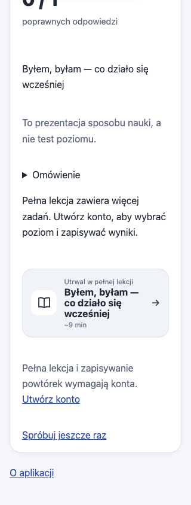

# PA-06 / PA-07: исправления ежедневного аудита

Источник: автоматический PO/Designer/QA-аудит 16 октября, снимок `c78bc01`.
Он повторно воспроизвёл два дефекта; исправления подготовлены поверх `178c463`.
Новые ID для тех же проблем не создаются. Это техническая регрессия, не
независимая языковая или ученическая приёмка материалов.

## PA-06 · P1 · язык интерфейса менял оценку аудирования

Форма отправляла `option|ui_text`, а сервер сравнивал выбранное значение
с исходным `answer`. На PL/EN переведённая подпись не совпадала с эталоном:
правильные ответы получали 0 баллов, отметки выбора исчезали.

Во всех четырёх группах `/listening/` значение radio теперь исходное,
независимое от языка; переводится только видимая подпись. Серверный контракт
и канонические ответы сохранены. Старые RU-формы остаются совместимыми;
открытую до выпуска PL/EN-страницу нужно обновить. Никакого доверия к оценке,
присланной клиентом, не добавлено. Результат этого практикума по-прежнему
не записывается в прогресс или экзаменационный балл.

Добавлена регрессия, которая читает фактические значения из отрендеренного HTML,
отправляет их и проверяет score, выбранные radio и отсутствие ложного разбора
неактивных групп. Она покрывает RU/PL/EN, A1–A2/B1/B2/слова и правильные,
неправильные, смешанные ответы. Отдельно проверен неизвестный ответ.

## PA-07 · P2 · текст карточки демо получал размеры иконки

Общий CSS задавал первому `span` размер 2,65 rem, считая его иконкой.
В демо первым был текст: название сжималось, выходило из карточки и
пересекалось с пояснением. Компонент теперь использует явные
`complete-next-icon` и `complete-next-copy` вместо позиционных селекторов.
Демо и все четыре варианта обычного завершения используют этот контракт.
Длинные подписи и названия переносятся внутри доступной колонки.

## Проверка

Chromium, локальный Django с отдельной мигрированной SQLite. Для private
listening — синтетический пользователь, внешние Auth/БД/ИИ отключены;
для демо — гость. Чужие аккаунты и production-прогресс не менялись.

| Сценарий | Объём | Результат |
| --- | --- | --- |
| Настоящая отправка listening-форм | 3 языка × 4 группы × 3 набора = 36 | Одинаковый score, все выбранные варианты остаются отмечены; закрытые группы disabled и не мешают required-validation. |
| Демо A1/A2/B1 | RU/PL/EN × 320/390/1440 px × light/dark × 3 уровня = 54 | Текст внутри карточки, нет горизонтального overflow и пересечения соседнего пояснения. |
| Навигация демо | Во всей матрице | Refresh сохраняет результат, переход ведёт на login с нужным lesson в `next`, Back возвращает карточку. |
| Обычные карточки завершения | 4 варианта × 3 языка × 3 ширины × 2 темы = 72 | Реальный общий шаблон отрендерен с длинными синтетическими названиями; иконка и текст раздельны. Это layout-фикстуры, не новые попытки уроков. |
| Клавиатура | PL/A2, 320 px | Фокус карточки → Enter → login нужного урока → Back. |

1069 Django-тестов, system check, migration drift и diff check прошли.
Первый запуск локального сервера был остановлен sandbox-запретом bind порта;
браузерные проверки выполнены после разрешённого запуска. Это не дефект приложения.

Схема, RLS/grants, задания, аудиофайлы и плеер не менялись. Физический Safari,
микрофон и качество озвучки этим прогоном не проверялись. Для выпуска —
обычные CI/Preview, после merge короткий smoke изменённых путей и error logs.
