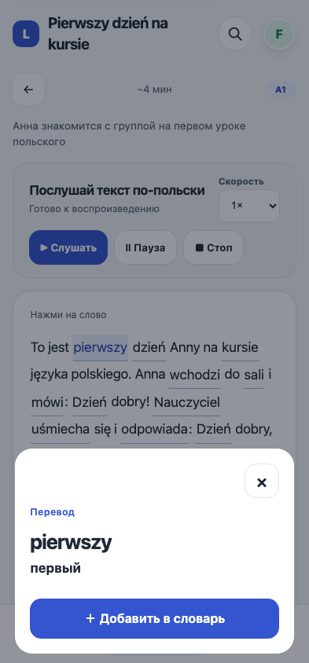

# Чтение — визуальное обновление 13 октября 2026

Продолжение DES-05: название текста в общей шапке, компактная строка
длительности/уровня и управление аудио, единая типографика и выделение слов.
Инструменты сохранения/подборок расположены после текста и учебных действий.
При наличии проверки понимания повторение слов имеет второстепенный стиль.

На ширине меньше 1000 px перевод открывается в native dialog поверх текста.
Закрытие кнопкой, Escape или снаружи возвращает фокус к выбранному слову
без прокрутки к концу текста. При расширении окна перевод возвращается
в desktop sidebar. Браузеры без native dialog сохраняют прежний inline fallback.
Канонический перевод и исходный контекст формы не меняются; системная
озвучка чтения сохраняет прежний механизм и требует отдельной проверки iPhone.

Скриншот локальной фикстуры, не production-аккаунт.

Проверки: 1032 Django-теста, system check, migration drift, diff check;
306 сочетаний остальных страниц/языков/тем/ширин; 54 сочетания чтения
(A1/B1/C1, RU/PL/EN, light/dark, 320/393/1440) в Chromium с проверкой
модального перевода, клавиатуры, возврата фокуса, позиции чтения и resize.
Node regression покрывает speech callbacks/pagehide, канонические поля
словаря, закрытие/resize/focus и inline fallback.

Проверки локальные; физический Safari/iPhone, VoiceOver и реальное сохранение
в Supabase этим прогоном не подтверждаются. Далее: письмо, аудирование,
экзаменационный рабочий экран и проверка с учениками.
