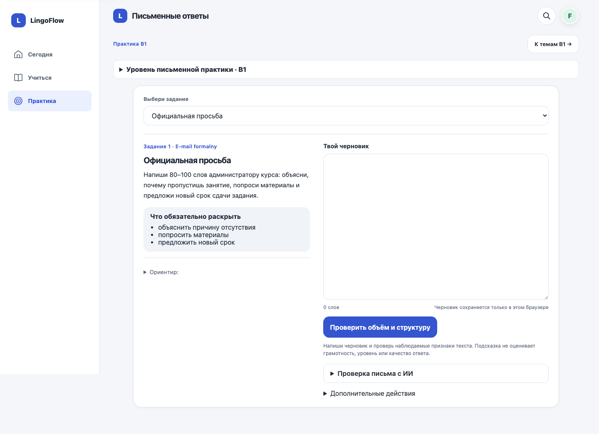

# Письменная практика — 13 октября 2026

Продолжение DES-05: общая шапка, единая рабочая панель, условие слева
и редактор справа на ширине от 1100 px. На телефоне блоки идут последовательно;
ссылка к черновику переводит фокус в textarea без JavaScript-обработчика.
Выделены обязательные пункты; подсказка остаётся свёрнутой. Пояснение о
пределах проверки расположено рядом с основной кнопкой.

Скриншот локальной фикстуры. Поля заданий, данные черновиков, проверка,
самопроверка и согласие на ИИ используют прежнюю логику. Результат базовой
проверки не является оценкой грамотности. Новая сетка ограничена обычной
практикой; экзаменационное письмо будет переработано отдельно.

Проверки: 1032 Django-теста, system check, migration drift, diff check;
108 раскладок A1–C2/RU/PL/EN/light/dark/320–1440; выбор задания, сохранение
черновика и отметок, refresh/Back, скрытие старого разбора при редактировании,
сброс с отменой/подтверждением. Дополнительно — 6 клавиатурных переходов
к редактору, 12 раскладок экзаменационного письма и 306 общих раскладок.
Браузер — Chromium, авторизация и данные локальные. Физический Safari/iPhone,
экранная клавиатура, VoiceOver и живой провайдер ИИ не проверены.
