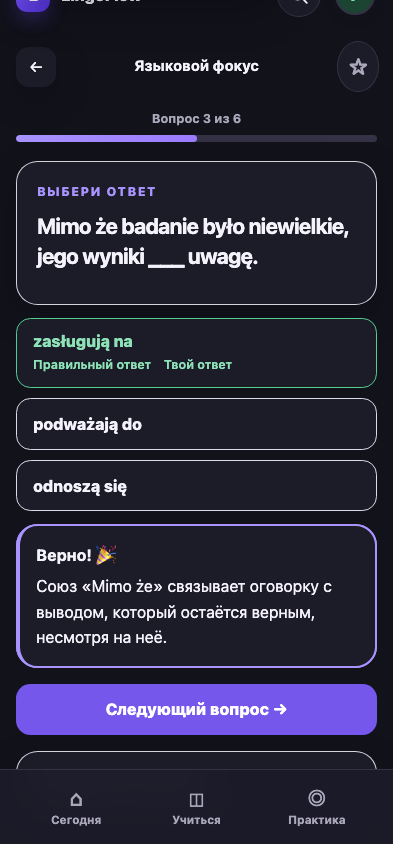
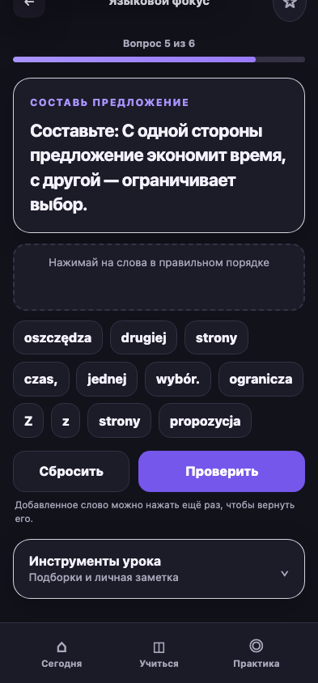

# Замечания пользователей iPhone — 12.10.2026

Основание: четыре присланных скриншота. Фото показывают старую навигацию из пяти
пунктов, поэтому проверены и текущие шаблоны на commit
`4323147283420ee536a5dc6c5f874c9dce8c103e`. Версия iOS и дата снимков неизвестны.
Красные отметки выделяют разбор; пояснения пользователя о точном смысле отметок
не получены. Исправлены подтверждённые проблемы оформления и языка.

| ID | Наблюдение / классификация | Изменение / приёмка |
| --- | --- | --- |
| IOS-01 | Bug, P2, Designer/QA, высокая уверенность: ответ и подписи «Правильный ответ / Твой ответ» слипаются и делят flex-строку; на фото `zasługują na` переносится в узкую колонку. | Текст ответа занимает отдельную строку, подписи расположены ниже с явным промежутком. Проверены правильный и неправильный ответ на 320/393/430/1440 px. |
| IOS-02 | Bug/improvement, P2, Designer/QA: стандартный Safari focus-ring вокруг `p[tabindex]` накладывается на рамку карточки; фокус нужен, оформление слишком тяжёлое. | Явный тонкий контур, без двойной рамки и тени. Фокус и переход Tab к следующему вопросу сохранены. Физическая Safari-проверка открыта. |
| IOS-03 | Bug, P2, PO/QA, высокая уверенность: RU-интерфейс показывает часть канонических PL-объяснений без перевода. На снимке `Forma ukończyła…`, также затронут `Mimo że…`. | 17 точных соответствий для «Биографии» и «Точек зрения» в display-only RU-наборе. Польские задания, варианты и исходные записи не менялись. PL/EN используют прежние переводы. Неизвестный PL-текст не переводится выдуманно и имеет `lang=pl`; цитаты внутри RU имеют `lang=pl`. |
| IOS-04 | Bug/risk, P2, QA: автоматический focus с smooth/nearest может оставить низ объяснения под фиксированным меню. На первом фото часть конструктора ниже края; его полная недоступность по одному снимку не доказана. | Автоматический переход без плавной анимации, явное выравнивание с отступом под меню и следующую кнопку; padding учитывает safe-area. После прокрутки все токены и кнопки конструктора доступны. |

## Проверка

1026 Django tests, system check, migration drift и git diff --check.
Chromium: 192 layout-проверки, 36 разборов и 12 конструкторов RU/PL/EN,
320/393/430/1440 px, тёмная тема; оба шестишаговых урока `bio-grammar` и
`b2view-grammar`. Отдельная RU-проверка финального контура и Tab: 32 layout-проверки,
6 разборов, 2 конструктора. Нет overflow и ошибок JavaScript; bounds объяснения
и кнопок проверялись относительно нижнего меню.
Auth — изолированная fixture, база — ранний локальный снимок. Одно объяснение
биографии подменено точным значением текущей миграции для воспроизведения фото.
Данные аккаунтов не сохранялись; уроки не завершались до записи результата.
Тесты русского набора сохраняют оригинальное `learning_text`, проверяют RU-разбор,
PL-цитату, PL/EN и честный fallback. Safari/WebKit и физический iPhone не запускались:
в окружении доступен только Chromium. Микрофон/PWA не проверялись.

## Пример после исправления — синтетическая браузерная сессия

## Следующая ручная проверка

На iPhone после загрузки обновлённой версии пройти `bio-grammar` (неверный
первый ответ и верный второй) и `b2view-grammar` (вопрос 3 и оба конструктора).
Проверить светлую/тёмную тему, открытые/свёрнутые панели Safari, портрет/ландшафт
и увеличенный текст: подписи не слипаются, разбор соответствует выбранному языку,
все слова и «Проверить / Следующий вопрос» доступны при прокрутке.
Зафиксировать iOS, режим Safari/PWA, язык и точный шаг; не присылать приватные
черновики или данные аккаунта. Это приёмка исправлений, не доказательство
того, что весь продукт стал проще. Для упрощений остаются три пользовательские
задачи: начать занятие, найти материал, повторить ошибку без подсказки модератора.
