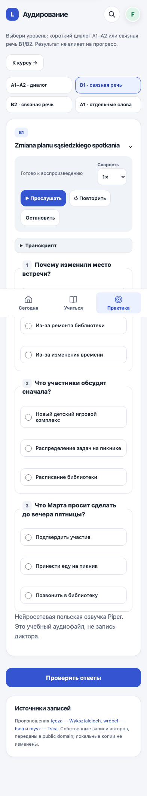

# LingoFlow: сравнение языковых приложений и аудит аудирования

Дата: 13 октября 2026. База: `e7177aa09e5e32660da5c9462e312b3c58416912`.
Запрос: изучить организацию, дизайн и материалы ведущих приложений;
параллельно продолжить DES-05. Это качественное сравнение четырёх подходов,
не рейтинг эффективности и не испытание платных приложений.

## Что изучено

| Приложение | Организация и материалы по первичным источникам | Что применить в LingoFlow |
| --- | --- | --- |
| Duolingo | Пошаговый маршрут, небольшие блоки, практика и истории внутри пути; можно возвращаться к темам. На официальном изображении октября 2026 выделен заголовок текущего блока и последовательность шагов. | Один следующий учебный шаг; повторение в обычном плане; цель темы понятна до начала. [Маршрут](https://blog.duolingo.com/new-duolingo-home-screen-design/), [актуальный пример повторения](https://blog.duolingo.com/how-to-review-lessons-on-duolingo/) |
| Babbel | Тематические units с учебной целью, несколькими уроками и recap; обычно 10–15 минут на урок. Материалы соединяют диалоги, грамматику, письмо и произношение. | Короткая жизненная задача в центре темы; взаимосвязанные примеры и итоговая практическая проба. [Описание курсов](https://support.babbel.com/hc/en-gb/articles/205600448-Babbel-courses) |
| Busuu | Коммуникативная цель, фразы в контексте, контролируемая и свободная практика; письменная/устная обратная связь сообщества. План учитывает цель, дни и длительность. | Явно объяснять, что ученик сможет сделать; разделять автоматический сигнал и человеческую проверку. [Методика](https://www.busuu.com/en/it-works/busuu-methodology), [план](https://help.busuu.com/hc/en-us/articles/16097312171153-What-s-a-Study-Plan-How-do-I-make-one) |
| LingQ | Чтение и аудио одного материала, сохранение значений незнакомых слов и повторение; выбор контента по интересам. В официальном Reader-изображении основное место занимает текст, перевод расположен рядом. | Связывать чтение → слова → повторение; доступный перевод рядом с текстом; аудио того же материала. [Организация обучения](https://www.lingq.com/how-to-use-lingq/), [руководство Reader с изображениями](https://forum.lingq.com/t/new-learner-guide/8719) |

Открыты официальные справки и публичные страницы, визуально просмотрены
официальные изображения Duolingo (2022 и 2026) и LingQ (руководство 2023).
Старые изображения — иллюстрация принципа, не подтверждение текущего UI.
Платные уроки, полный контент, приложения iOS/Android и результаты обучения
конкурентов не проверялись. Тарифные ограничения не используются как критерий
качества. Чужие уроки/изображения не включены в материалы LingoFlow.

## Вывод для продукта

Предлагаю сохранять три основных входа «Сегодня / Учиться / Практика».
Рабочий экран показывает задание и одно основное действие; подробности
доступны по запросу. Тема должна связывать словарь, пример, упражнение,
самостоятельное применение и запланированное повторение одной ситуации.
Это проектное решение по сравнению подходов, а не доказанная универсальная
методика. Для подтверждения понятности используем существующий PA-04/beta.

Визуальное направление: взрослый учебный интерфейс, единые иконки,
выразительная типографика, заметный выбранный ответ и спокойные поверхности.
Количество пройденных уроков не представляем как подтверждение владения CEFR.

## Покрытие этого запуска

| Среда / путь | Что проверено | Ограничение |
| --- | --- | --- |
| Production Chromium, 393/1440, гостевой RU | `/`, `/demo/`, `/login/`: шесть посещений, статус и переполнение | Без выполнения демо, входа и account persistence |
| Local Chromium, RU/PL/EN, light/dark, 320/393/430/1440 | 24 раскладки аудирования, 72 сценария play/stop/repeat/end, фрагменты; семь AAC декодируются с ненулевым сигналом | iPhone UA не является физическим iPhone; качество голоса не оценено носителем |
| Local B1 | Переключение уровней, ответы, B1-only submit и refresh, три языка | Авторизация/хранилища — фикстуры; данные не отправляются в Supabase |
| Local результат B1, RU dark | Измерен контраст правильного/неправильного пояснения до и после исправления | Не полный WCAG-аудит |
| Local общие страницы | 306 раскладок, клавиатурные переходы и отсутствие page errors | Эти посещения не являются полными сценариями сохранения всех навыков |

Не запускались: физические Safari iPhone/Mac, микрофон, VoiceOver, потеря сети,
полный B1 timeout/history, удаление аккаунта, живой ИИ и независимая проверка
всех языковых материалов. Их существующие пункты роудмапа сохранены.

## Находки и решения

### LIS-01 — контраст пояснений в тёмной теме

- Тип: bug; Designer/QA; P2; уверенность высокая; исправлено в этом пакете.
- Путь: аудирование B1 → ответы → разбор. Локальная фикстура RU, dark, 393 px.
- Воспроизведение: открыть B1, выбрать первые варианты в первых двух
  вопросах и второй в третьем, проверить ответы.
- Наблюдение: текст correct `#176b47` на `#163a2b` даёт 1,93:1;
  wrong `#a52f46` на `#42202a` — 2,10:1. Объяснение трудно читать.
- Ожидается: обычный текст разборов имеет контраст не ниже 4,5:1;
  смысл дополнительно передаётся словами.
- Решение: текст использует цвет темы; фон и подписи результата сохранены.
- После исправления: 11.16:1 для correct и 12.69:1 для wrong.
- Приёмка: измерение обоих состояний; стоимость S, внешних зависимостей нет.
- Основание: [WCAG 2.2, контраст текста](https://www.w3.org/WAI/WCAG22/Understanding/contrast-minimum.html).

### DES-05 — единый рабочий экран: пакет аудирования

Improvement; Designer/PO; P2; реализована часть существующего пункта.
Название в общей шапке, компактный выбор уровня и только один видимый рабочий блок
при включённом JavaScript; плеер с понятной скоростью,
нумерация вопросов, заметные выбранные варианты. B1/B2 транскрипт раскрывается
по запросу и открывается после проверки, оставаясь в DOM и доступным без JS.
Фрагменты A1–A2 находятся в отдельном раскрываемом блоке. Без JavaScript
три языка проверены на доступ к транскрипту через native details. Медиафайлы,
лимиты/проверка/формы и сохранение выбора между уровнями не менялись.

Основания: [раскрытие второстепенных действий](https://www.nngroup.com/articles/progressive-disclosure/),
[предсказуемая навигация](https://www.w3.org/WAI/WCAG22/Understanding/consistent-navigation.html).
Это выбор для обычной практики; экзаменационный сценарий остаётся отдельным.

### BM-01 — явный учебный результат темы

Improvement; PO/Designer; P2; уверенность средняя; будущий пилот, стоимость S/M.
В `course.html` тема показывает название, description и процент уроков;
отдельная формулировка практического результата не выделена.
Проверить существующие описания и оформить три пилотные темы A1/A2/B1 как
«после темы смогу …» с одним наблюдаемым действием. Использовать существующие
поля, избегая дублирования описания. Приёмка: ученик до начала может объяснить
цель; преподаватель связывает её с итоговой пробой. Опора: Babbel/Busuu выше.

### BM-02 — связанный сценарий вместо разрозненных материалов

Improvement; PO; P2; уверенность средняя; стоимость M, требуется редактор.
Шаблоны курса связывают слова/грамматику/чтение/quiz; письмо, speaking и
три общих записи аудирования открываются через отдельные тренажёры.
Составить карту трёх пилотных тем: одна ситуация, повторяемая лексика,
диалог/текст, управляемое упражнение, короткий самостоятельный ответ.
Проверить существующие связи и переиспользовать материал, а не увеличивать
количество меню. Приёмка: каждый шаг поддерживает цель BM-01; объяснения
показывают причины ошибок; польский редактор проверяет содержание и distractors.
Качество всех текущих материалов в этом запуске не оценивалось.

### BM-03 — вернуть полезный материал в повторение

Improvement; PO/QA; P2; уверенность средняя; стоимость M.
Чтение уже ведёт в словарь, уроки имеют followup и Today; listening явно
сообщает, что результат не влияет на прогресс. Для пилота BM-02 связать
результат с одним полезным существующим шагом и действующим расписанием
повторения. Не начислять учебный прогресс до проверки реального сохранения.
Приёмка: заданное повторение появляется в Today, проверяется запись хранилища,
успешная попытка закрывает его. Опора: Duolingo/LingQ выше.

Статус на 16 октября: **BM-03 выполнен**. Настоящее A2-повторение от результата
0/5 предыдущего дня появилось в Today; новая попытка 5/5 сохранилась и закрыла
закрепление, сохранив завершённое задание, галочку и рост прогресса.
[Production-протокол](pilot-result-recovery-2026-10-15.md#следующая-календарная-проверка-bm-03).

### Существующие P1 и внешние зависимости

На момент аудита записи диктора и Safari оставались внешними зависимостями.
15 октября пользователь принял текущую синтетическую речь; записи диктора
больше не обязательный блокер. Пользовательская физическая приёмка текущей
web/PWA также записана отдельно. Piper не обозначается записью диктора.
Живой ИИ, права, независимая проверка материалов и PA-04 остаются отдельными
задачами; сравнение конкурентов и BM-03 не закрывают их.

## Доказательство оформления

Release-проверки: 1032 Django-теста, system check, migration drift, diff check;
Node audio lifecycle, отказ/timeout/stale events и pagehide; браузерные
проверки, перечисленные выше. UI-тест заголовка обновлён под новую шапку.
